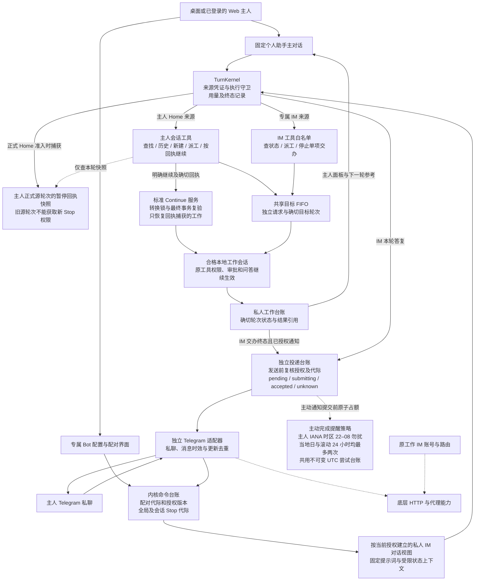
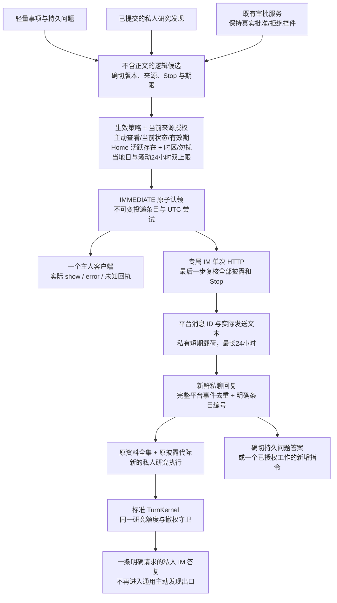

# 个人助手

个人助手在侧栏有固定入口，使用同一数据根内唯一的私人会话。它经正常的聊天内核接收主人指令，使用会话工具查状态、创建工作会话或派工。专属 Telegram 私聊通过独立配对和会话授权接入；早期产品比较及扩展方向保留在[设计提案](../../proposals/personal-assistant/im.md)，实现边界以本文为准。

2026-11-15 的[主动助理设计](../../proposals/personal-assistant/README.md)分 A/B/C 实施。A（#919）引入轻量事项、持久问题、结果核实回报及累计额度；B（#920）加入来源研究；C 加入统一注意力、免打扰与 IM 接续。三部分共同验收后统一发布。Goal 关注保持独立可选，不是事项的控制器。

## 数据和执行

`SessionKind::PersonalAssistant` 的主会话由 `ensure_personal_assistant_home` 原子取得。会话创建和跨会话指令按源轮次、工具调用标识防重。交办台账与目标的用户消息、轮次在同一事务关联，轮次通过 `TurnKernel` 执行。目标繁忙时，指令进入与桌面、HTTP、IM 及排程共用的 FIFO。

主对话的本轮可以先结束。Primary 每两秒检查可运行的队列及实际轮次状态，前端按回执显示排队、运行、完成、中断或失败。回执作为不可信参考数据注入主人下一轮的上下文，不能自行授权下一次执行。进程重启后按原轮次对账，已经完成的工作不会重新派发。

取消指向请求绑定的确切轮次，取消排队指令直接删除对应队列项。所有派工同时遵守源、目标和全局 Stop 代际。

主人可在私人主对话中明确要求继续指定工作会话。正式源轮次准入时，内核保存合格目标当前暂停回执的不可变快照；`session_status` 只向这一本人前台源轮次提供已捕获的回执，`session_continue` 按目标与确切回执恢复当次暂停的控制器。执行在标准 Stop 转换锁内检查，并在最终事务再次核对源轮次、目标资格、当前回执及 Stop 代际；旧源轮次不能清除新 Stop。普通会话仍只能继续自身，专属 IM 不开放跨会话 Continue。恢复不会重新派发已中断的普通任务，需检查既有结果后另行交办。

## 轻量事项与后续所有者

`ha-assistant` 在 `wire_features()` 注册 Primary 专用协调器，每两秒通过内核类型化服务对账。`assistant_items` 引用原派工请求；接单、共享 FIFO、预算预占及正式轮次关联在同一事务中提交。事项只有进行中、等待、已交付、已停止四态。请求 completed 只表示一轮执行终态，不等于整件事交付。

正式工作流通过 `assistant_report` 提交已回读核实的结果、具体后续、外部等待或失败。协调器仅结算当前有效执行的报告，报告缺失或失败保持待核实。相同输入与计划连续两次无进展停止自动复跑。默认委托七天到期；停止不会因晚到结果重新打开。

`assistant_execution_contexts` 绑定不可变 persistence run ID，`assistant_owned_sources` 绑定真实 job/subagent ID 与父执行角色。子代理及其嵌套结果注入始终是子任务，不能报告整项完成。内部子工作只有标准父注入一个后续拥有者；事项协调器等待它交还控制。快速 inline 工具的预分配来源明确结算为当前执行，不作为不存在的后台作业等待。已提交、运行中、可安全重试与未知副作用分别处理。

不含提示词和结果的 `assistant_execution_receipts` / `assistant_source_receipts` 在同一事务保存确切执行、子任务与子会话身份，不随内容删除。归档、删除或撤销规范归属后，这些凭据只用于拒绝旧执行、拒收迟到结果及取消确切后台工作，不授予新的执行权；恢复会话不会恢复旧授权。级联删除归属前同时关闭对应持久问答。

`assistant_item_questions` 与既有 `ask_user_questions` 共用展示与回答协议。创建问题、封闭原执行、事项 waiting 及 Home 更新同事务写入；正常结束本轮，释放模型槽。回答携 `assistant_item_answer` 的确切事项版本与执行 ID，事务中检查当前权限、pending、Stop 和答案后写唯一后续；重启不依赖 oneshot。超时、fallback、重复回答或旧按钮不触发动作。即刻回答也不能重新放开原执行。

单项默认 8 个正式轮次、64 次工具、1800 秒累计活跃执行；主人滚动 24 小时默认 16 轮、128 次工具、3600 秒。主模型、辅助模型、核实、重试和子代理共享事项额度；实际用量仍走 `model_usage`。审批等待及等待子工作不计活跃时间。`assistant_owner_turns`、`assistant_budget_reservations` 和明确追加的 `assistant_budget_grants` 不随内容级联删除；未知预占保守保留。主人可显式追加一份有界额度，存在内部后续拥有者时只追加、不再派第二个消费者。

主模型所属确切流已持久终态时，未知预占继续扣账但不占在途并发槽。工具及后台辅助模型的未知预占仍占槽，不能借父流已结束推定实际工作已终止。主人补充在原请求排队时保持待处理；只有确切消费者提交才算交付。补充消费者失败后的显式继续将未交付内容交给核实轮次，不认证旧副作用，也不盲目重放写操作。

单事项停止先在 DB 封存新代际、取消后续与问题，再按台账列出的确切 request、persistence run、job 和 subagent 调用现有取消服务。Primary 轮询使 Secondary 受理的停止收敛，进程内没有 token 不代表远端执行已终止。不会按整个 session 误停无关工作。

首次实现仅支持可携带事项身份的普通工具和标准子代理。旧 `exec background/yield_ms` 进程模式、尚未继承事项身份的独立控制器及尚未继承事项身份的自定义 Hook 保持拒绝；准入和工具执行都检查当前工作区及全局 Hook 配置。可改用受管 `run_in_background` 作业或无自定义 Hook 的工作会话，不能降为普通执行绕开额度。

`assistant_updates` 是独立于聊天消息的不可变时间线条目，不另开模型轮次或抢占输入。主人主动点「查看更新」才记 viewed；出现窗口或滚入视口不算已读。事项详情默认折叠，执行历史和旧 Goal 关注保留在按需打开的面板中。

## 私密边界

首期接受尚未挂接工作 IM、未归档的本地普通顶层会话。无痕、导入及其他专用会话被拒绝。接单后的目标持久标记为助手私有，后续也不能挂接普通 IM。其他模型会话与通用 `/sessions` 选择器无法搜索私人主对话或私有工作会话，自动记忆提取与贡献、复盘文本分析跳过这些会话。

模型侧全局检索在 FTS / trigram 选取命中和应用限额前过滤私有标记。来源由绑定的执行上下文裁决，模型不能通过参数自报主人权限。展示命中时，在同一只读事务中再次核对来源与目标资格，并重读当前标题、正文和邻文；已经失去授权的旧命中也不输出。普通工作来源可以明确查询自身的私有会话，真实主人主对话可查询其有权查看的私有工作，主人界面的搜索继续使用自己的访问路径。

主人在桌面可以查看私人主对话、工作面板和原会话。启用后，该数据根的 HTTP 服务须配置主人令牌。HTTP 管理接口核验主人身份，WebSocket 以及通用资源票据使用主人专用 scope，旧的普通事件或资源票据无法读取私人数据。配置令牌前，匿名 HTTP 被拒绝，桌面入口仍可使用。

## Goal 关注

主人可选择一个已有 Goal 建立本地关注。首次记录基线，随后进入阻塞或完成待验收时产生事项。重复事件及描述修改不产生新提醒，来源失效后停止披露。读取和比较状态沿用 Goal 台账，不调用模型。关注和已读不会改变 Goal 的完成或验收结果。

## 助手身份与界面

全局侧栏顶部固定显示助手头像，不随窗口高度收进「更多」，与其他入口一样采用纯图标布局。完整名字在悬浮提示与主对话身份栏显示，默认名字为 Hope。入口始终打开同一个 `personal_assistant` 主对话。主对话使用独立身份栏，并复用共享工作台的标签、切换、关闭、悬浮、最大化及重新展开控件；工作台进入整页布局时，身份栏让出空间。交办工作和关注目标放入可收起的「事项」面板，宽窗口在右侧显示，小窗口使用有焦点约束的弹窗；打开事项会收起工作台，但保留标签并可重新展开。「助手设置」集中提供助手资料和 IM 连接，主对话及事项面板不再挂载 IM 配置表单。

助手默认以对话为主：身份栏保留头像、名字和设置，搜索与全部事项收进「更多」菜单，存在待回答或待处理事项时才显示直达按钮。欢迎区只保留一句带名字的问候。输入框默认显示附件、语音、发送 / 停止与「对话选项」入口；展开选项后复用原有模型、思考、权限、工作目录与模式控件，切换会话时收起。任务进度默认显示紧凑状态，可展开或打开工作台查看详情。事项面板默认关闭，工作台首次进入助手时默认收起；自动到达的镜像帧和后台任务不展开工作台，任务、文件与来源不自动打开 Workspace。用户点击文件、详情或工作台入口仍显式展开，已打开面板的标签及交互保持不变，返回会话时恢复其工作台状态。普通工作会话沿用原有显示与自动打开策略。

`AssistantProfile` 传输类型由 `ha-config-schema` 定义，内核原路径再导出。名字与头像保存在 `sessions.db.personal_assistant_profile` 的唯一资料行，缺省为 Hope 和空头像；空头像在侧栏、身份栏及助手设置中统一显示随包的 Hope logo。默认读取不创建资料行或主对话。保存只更新资料行，不重命名会话、不改 Agent、不修改历史、交办、关注及 IM 授权；重启仍使用原主对话。保存后的无敏感载荷 `personal_assistant:changed` 使主人界面重新读取投影。已保存的资料也使数据根进入私人访问保护。

名字去除首尾空白后要求 1–32 个 Unicode 字符，拒绝控制字符。头像只接受三个内置预设或头像目录内已上传的普通图片文件，不接受外部 URL、任意主机路径和越界符号链接。上传与裁剪复用现有头像入口，保存资料成功后才对其他界面发布。文件暂不可读时界面回退到默认头像。名字在主人主对话的轮次参考数据中提供，仅用于自称，不作为指令或授权；其他 Agent 和专属 IM 视图不取得私人资料。

读写资料的桌面与 HTTP API 都是主人界面入口，不开放模型写入。`ha-settings` 的 `personal_assistant_profile` 为只读说明类别，仅返回固定脱敏占位与设置位置，不查询私人资料；`update_settings` 拒绝该类别。前端按连接代际清理资料、草稿及延迟保存结果；顶层侧栏身份由 `usePersonalAssistantIdentity` 投影，资料回调绑定来源连接代际，拒绝旧回调覆盖或清空新连接身份。隐藏或关闭设置及切换标签时卸载 IM 配置组件。

## 专属 Telegram 入口

主人在「助手设置 → IM 连接」填写一个新建 Telegram Bot 的凭据。凭据写入独立的受保护文件，状态 API、配置导出和事件均不返回凭据。`getMe` 返回的稳定 Bot ID 在 `im_bot_purposes` 中认领用途；同一个 Bot 不能同时作为工作 Bot 和个人助手 Bot，换 Token 不改变用途。工作 Bot 的启停及编辑也核验该认领。

配对按「主人取得短时一次性码 → 本人向 Bot 私聊发送码 → 主人在 HA 核对用户及私聊 ID → 本人在该私聊点击启用」推进。群聊、频道、转发消息及通过其他 Bot 发送的内容不受理。配对前、启用前的普通消息不成为新指令；平台消息超过五分钟或比本机时间超前三十秒时，仅消费更新，不执行。已在时效内受理的命令再按冻结授权及 Stop 代际处理。原始平台更新先按 Bot、更新 ID 和配对代际防重，再提交命令台账。桌面和 HTTP 主人确认候选时只将启用消息入队，Primary 统一消费；因此 Server 为主进程、桌面为控制端时也能完成配对。启用消息的短时 nonce 在专属私有台账中待发，领取、撤销或过期后清除；提交后结果未知时不自动重发。撤销配对或替换连接会废弃旧授权、待处理命令和待发消息。

每个工作会话分别授权「查状态、派工、停止交办、完成通知」并设置有效期。后三项要求同时允许查状态。配置、配对及授权只开放给桌面主人和已验证的 HTTP 主人，没有模型工具入口。已有工作 IM 绑定、无痕、导入及特殊会话不能授权。授予权限不会把原会话的全文提供给 Telegram。

### 对话视图和执行来源

IM 视图按连接、配对代际和会话授权版本划分。主人桌面主对话的历史、自动记忆、工作目录提示词、自定义 Agent 指令和 IDE 上下文不进入该视图。模型只得到当前授权的状态投影，工具白名单进一步限制可读范围与可执行操作。更改授权后使用新视图，旧历史不会在扩大或缩小权限后重新进入上下文。普通会话检索、自动记忆和工作 IM 无法读取这些视图。

平台来源由内核台账封存，模型不能提交用户 ID、连接 ID 或授权版本来升级来源。命令在执行前、工具调用时及交办入队时复核当前配对、授权和 Stop 状态。后台执行仍走 `TurnRequest`、来源专用 `TurnSubmission` 和 `TurnKernel`，不建立另一套 Provider 或工具循环。IM 不能借派工把状态查询权限变成完整的主对话读取权限。

### 结果投递与重启

Telegram 的普通工作通知默认只回复受限状态，结果正文与原始消息由主人回到 HA 查看。轻量事项的原始及后续 request 都以永久身份收口，不再逐轮报告完成。桌面交办须另外开启 `desktopToImNotices`，且对应工作仍须有查状态和完成通知授权；共享资料摘要则使用下文独立的来源披露授权。暂停期间的终态不会在恢复后补发，暂停不影响合格普通对话的即时回复。派工使用相同请求台账与目标 FIFO，停止动作指向该请求绑定的轮次，不代替整会话的 Stop / Continue。

主动提醒使用助手设置中主人明确指定的 IANA 时区，默认 22:00–08:00 免打扰；当地日和滚动 24 小时均最多两次。没有有效时区时保留待发，不猜测 Server 或设备时区。旧有效资料时区仅作为迁移来源，之后以助手设置为准。即时私聊答复不占主动额度，也不会被延后的完成提醒阻塞。发送前在同一 `IMMEDIATE` 事务中写入 `assistant_im_notification_attempts` 并进入 `submitting`；结果未知或提交后崩溃仍占一次。该台账只留投递 ID 与 UTC 尝试时间，独立于连接和会话的删除，解绑重配不会重置名额。待发完成提醒仍遵守原授权有效期和最长 24 小时保留期。

`assistant_im_activations` 单独记录配对启用消息，`assistant_im_commands` 与 `assistant_im_deliveries` 记录命令和普通出站尝试，Primary 单独运行接收、命令处理和投递循环。发送前重新核对授权版本、有效期、配对代际和目标资格。只有平台返回消息 ID 才记录 `accepted`，不把它表示为已读。跨过 `submitting` 后出现超时或进程重启记为 `unknown`，不自动重发；已经提交的消息也不能通过删除本地台账撤回。

## 共享资料与主动发现

主人在助手设置的「主动关注」中选择一个合格本地工作会话、工作目录内文件、关注主题和 1–30 天期限。最多四份 UTF-8 普通文本，每份 64 KiB；不接纳无痕、归档、导入、Cron、子会话、工作 IM 或已有评测来源。读取复用 `WorkspaceScope`，先核对冻结工作目录，再用跨平台 `open_file_beneath` 打开同一个受限文件句柄；不跟随符号链接、重解析点或特殊文件。首次读取只保存基线。读取授权和自动观察的 Stop 回执分开；显式主人检查不能被旧后台任务借用。

Primary 的资料扫描与两秒事项协调分开，文件 IO 不阻塞工作结算。资料每三十分钟到期检查；变化产生持久事件，无变化每两小时最多一次语义复查。只在全部当前关注来源可核实时组合研究；离线、读失败、丢失中间版本记录为观察缺口，不能宣称“没有变化”。来源内容和关注文本都是不可信数据，不是新指令。

研究通过 `TurnRequest`、专用 `TurnSubmission::assistant_research` 和 `TurnKernel` 进入标准运行时。每次发现或主动追问使用新的 `personal_assistant_research` 私人会话、不可伪造来源凭证、固定系统提示词和只含报告工具的能力集。不加载 Home 历史、自定义 Agent、自动记忆、技能、工作目录提示词或 Hooks。不能读其他文件、执行 shell、MCP、写文件、创建后台作业或委派。需要实际执行时，主人另行交办到普通工作事项，沿原权限和审批。

每次研究最多两次实际准备后的 Provider 生成尝试、八次工具调用、九十秒；原生协议修正和 fallback 也占次数。每个主人滚动二十四小时最多八次尝试，失败或结果未知不退款，删除 Home 不清账。研究不调用远程 token 计数、压缩及其它辅助模型；实际 Token 用量仍由标准用量链路记录，本地容量估计不冒充账单。发送前的最终 claim 在同一事务重查 exact run、全部输入来源、版本、期限、策略与 Stop。

报告区分事实、判断、待确认内容、准备好的方案及实际输入版本/行号。`reported` 只代表提案；标准 stream 为 `committed` 且全输入仍有效后才发布。主题和语义相同的发现去重，不重置已读。发现是主人专属投影，不进入普通消息历史、搜索、导出、上下文快照、流重放、Hook 转录或 IM 镜像。即使正文只引用一份资料，撤回任一实际输入来源也会让整份结果失效。研究身份用独立凭证保留，删除会话不能把旧执行变成普通执行。

Home 保留紧凑发现卡片，点击才标记查看；展开后可看判断、方案、来源，并在该卡片内追问。追问创建新的来源内研究，有持久状态和实际失败原因，不假装排队就已完成。前端在失去主人身份、切换连接、隐藏页面或收到撤权提示时丢弃正文和晚到响应。模型在普通 Home 只获得不含正文的发现引用，不能把私人资料转交普通工作。

助手策略用共享 `assistant_policy_gate` 记录请求与生效版本。只有 Primary 经 `mutate_config_async` 标准写入并确认后才生效；待处理或失败保持研究关闭。暂停立即停止当前事项并清除研究派生内容；恢复不会重启已停止事项，资料重新建立安静基线。开启/关闭额外发现不等同于授权新来源；`ha-settings` 只能读固定脱敏说明，不能改写。

外部依赖等待可在 `assistant_report` 中同时给出 `next_instruction` 和 60–86400 秒的 `resume_after_seconds`。已提交报告结算与到期跟进在同一数据库事务登记，重启不丢失，不另开 Cron 控制器。到期仅在原事项仍有效、没有待答问题、原执行已结束且尚有累计额度时排队一次；停止、到期、已核实完成会封住旧检查。等待用户的问题不能设置自动重试，也不能因超时得到默认同意。

## 统一反馈、免打扰与手机接续

`personal_assistant/attention` 统一处理已核实交付、尚待回答的问题、需要处理的阻塞、正在等待主人裁决的审批及当前私人资料发现。普通进度和例行外部复查留在 Hope，不逐条外推。`ha-assistant` 每两秒刷新候选；每个逻辑更新最多取得一个投递身份，不因换渠道、重启、删除内容或未知发送状态重复认领。普通结果合并等待六十秒，每批最多四项、单条约三千 UTF-8 字节；问题与审批可省去合并等待，仍遵守勿扰和额度。

主人从「仅在 Hope 内 / 桌面通知 / 助手 IM」选择一个主动渠道；新用户默认不外推。来源读取、IM 摘要披露、实际执行权限和 strict 审批分别裁决。每份资料的摘要开关默认关闭，保存时同时核对来源读取版本、当前配对 ID/代际和独立披露版本。涉及多份输入的发现须全部允许披露；撤销再开启不会让旧消息取得新授权。桌面交办到 IM 的开关仅允许状态，不以目标会话权限推定环境资料正文的完整来源。

桌面客户端以随机主人客户端 ID 每十秒续约三十秒的 Home 活跃存在，失焦、隐藏、离开 Home、卸载或换连接时清除。存在与已读分离，不自动把更新或卡片记为已读。任何当前 Home 客户端活跃时暂缓主动外推；本机在前台时不认领原生通知。前端每次通过捕获的当前连接读取通知偏好，不借旧连接的全局缓存披露新数据，也不在后台弹权限申请。JS 返回不算平台接收；缺少实际 show 回执时为 `unknown`，`accepted` 也不表示已读。

所有主动渠道及兼容的旧完成通知共用 `assistant_im_notification_attempts`。尝试在原子认领时占额，无外键、不退款；未知、明确未提交、删除事项及重配均不会补额。计数同时投影到主人当前当地日及不可变 UTC 的滚动二十四小时，时区变更、午夜、DST 和时钟回拨不能补出名额。恢复专属 IM 的通知开关会推进独立边界，不补发静默期间的旧结果，也不影响桌面选路或明确请求的私聊答复。边界按 UTC 秒保守封口：与启用或恢复同秒的主动更新只留在 Hope，严格晚于该秒的更新才可外推。

助手主对话自身的直接审批与直接问答通过 `assistant_attention_home_handoffs` 登记无正文的待处理提醒。登记保存工具上下文的准入 Stop 代际，缺失或与当前值不同则拒绝；认领均验证确切前台 stream、Desktop/HTTP 用户源轮次、Home 与全局 Stop 代际、问题待答状态、期限及进程内 live 身份，复用统一免打扰、存在状态、额度与去重。仅主人已选择桌面通知时外推，不借用工作会话的 IM 授权；响应继续进入原审批或问答入口。回答、超时、取消与 Future Drop 先同步封闭 live 身份，再异步清理原数据库，不阻塞真实裁决。开始与结束相同表示全天免打扰。设置页显示延后原因、主人时区的下次可尝试时间和最近回执；额度不改变执行权限。

私人发现认领前以专门的 Attention 读取凭证重新读取确切文件，读取前及写回快照时均复核范围。投递条目冻结来源 run、实际全部输入、Stop、披露代际及会话授权版本；IM 的完整复核是实际 HTTP 前最后一个等待点。进入 `submitting` 后不自动改投或重试。时间敏感发现可声明 `attentionUntil` 的绝对 RFC3339 期限，只能缩短最多二十四小时的提醒有效期，不能突破免打扰或提升紧急性；不把空发现列表视为问题已解除。

平台回复只保留新消息、父消息 ID 和新文本，不读取引用正文。完整防重键为连接、配对代际、游标代际和更新 ID。未知引用原子忽略；只有确切已接受且授权仍有效的普通对话出站记录才允许沿普通 IM 路径处理。已知注意力消息即使失效也不回落普通历史。合批消息须用“编号: 问题”选择一项，含糊选择只返回无正文的编号提示。超长、空白、已回答、过期或队列已满的输入仍消费游标，不阻塞后续消息。

资料追问绑定当时实际发送的有界文本和原始输入全集，创建新的封存研究查询，不能借同一 finding ID 后续换用的 run 或扩大的来源。短期载荷只放 `assistant_attention_payloads`，不进入 Home、普通 IM 消息、搜索、记忆、导出或 Hook；来源变化/撤回、披露撤回、相关会话删除或过期会清除。研究准入、文件读取、工具调用及真实 Provider 发送均核对 `im_reply_id` 的当前配对、披露代际、Stop 和期限。主人明确请求的答复不占主动提醒额度，也不受主动勿扰限制，但所有来源、停止和研究执行额度仍生效。其结果只有一次 IM 答复处置，通用发现扫描不再外推。

手机可回答确切仍 pending 的持久事项问题；回答与新后续在同一事务登记，不处理默认答复或 strict 审批。已完成/阻塞工作上的新指令只携一个当前获准目标及主人新文本，不带资料正文。审批通知仅引导回 Hope 作真实裁决。审批响应和 Stop 不等待通知账本：同步关闭活跃投影后先送达真实裁决，持久通知清理在后台进行。

旧 `job:completed`、工具主动通知、问答及审批的原生提醒按确切永久执行/job/子任务身份折叠。专用 Home 来源与 A 工作会话的宽泛私密标记不同：同一普通工作会话后来由主人直接发起的普通轮次保留原行为。Home 直接后台、自动后台、旧 exec 进程模式、子代理启动或独立控制器被执行前及底层来源守卫拒绝，模型须通过既有 `sessions_create/send` 明确交办剩余工作，不自动重放原请求。无有效 A 凭证的 Home 遗留父注入在写消息前拒绝；有效 A 子工作沿原后续链路继续。

## 诊断

- 找不到主入口时，核对当前数据根和 `personal_assistant` 会话类型。
- 交办排队时，先查看目标的 FIFO、当前轮次和暂停状态。重复点击或重启不会放行暂停前的旧指令。
- 请求结束状态以绑定的 `chat_turns` 为准。中断和无法确认结果的任务由主人决定如何接续。
- Web 提示需要鉴权时，配置当前服务的 Owner Token 并重新登录。凭据放在 header 或登录请求体中。
- 工作 IM 拒绝挂接目标时，检查目标是否持有私人交办标记。
- 专属 Bot 无法保存时，检查稳定 Bot ID 的用途认领及原工作 Bot 身份能否核验；不要通过换 Token 绕过用途冲突。
- 配对停留在待启用时，核对 HA 中确认的私聊身份、一次性启用按钮和配对有效期。重新配对后旧消息不会自动执行。
- 能收到指令却不能派工时，核对该会话的授权版本、有效期和 Stop 状态；源消息中声称已获授权没有效力。
- 投递显示 `unknown` 时，先在 Telegram 人工核对是否已收到。不要把未知投递重置为 `pending`。
