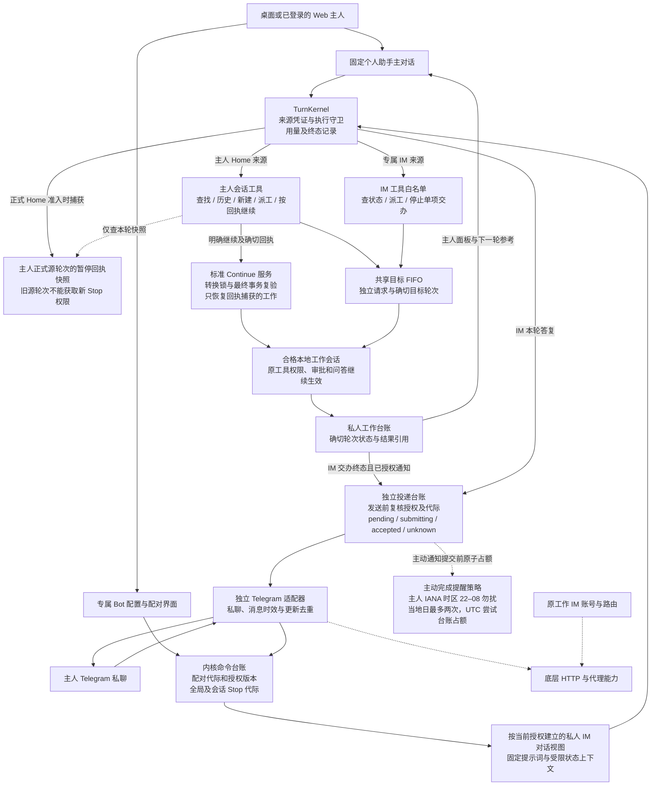

# 个人助手

个人助手在侧栏有固定入口，使用同一数据根内唯一的私人会话。它经正常的聊天内核接收主人指令，使用会话工具查状态、创建工作会话或派工。专属 Telegram 私聊通过独立配对和会话授权接入；早期产品比较及扩展方向保留在[设计提案](../../proposals/personal-assistant/im.md)，实现边界以本文为准。

## 数据和执行

`SessionKind::PersonalAssistant` 的主会话由 `ensure_personal_assistant_home` 原子取得。会话创建和跨会话指令按源轮次、工具调用标识防重。交办台账与目标的用户消息、轮次在同一事务关联，轮次通过 `TurnKernel` 执行。目标繁忙时，指令进入与桌面、HTTP、IM 及排程共用的 FIFO。

主对话的本轮可以先结束。Primary 每两秒检查可运行的队列及实际轮次状态，前端按回执显示排队、运行、完成、中断或失败。回执作为不可信参考数据注入主人下一轮的上下文，不能自行授权下一次执行。进程重启后按原轮次对账，已经完成的工作不会重新派发。

取消指向请求绑定的确切轮次，取消排队指令直接删除对应队列项。所有派工同时遵守源、目标和全局 Stop 代际。

主人可在私人主对话中明确要求继续指定工作会话。正式源轮次准入时，内核保存合格目标当前暂停回执的不可变快照；`session_status` 只向这一本人前台源轮次提供已捕获的回执，`session_continue` 按目标与确切回执恢复当次暂停的控制器。执行在标准 Stop 转换锁内检查，并在最终事务再次核对源轮次、目标资格、当前回执及 Stop 代际；旧源轮次不能清除新 Stop。普通会话仍只能继续自身，专属 IM 不开放跨会话 Continue。恢复不会重新派发已中断的普通任务，需检查既有结果后另行交办。

## 私密边界

首期接受尚未挂接工作 IM、未归档的本地普通顶层会话。无痕、导入及其他专用会话被拒绝。接单后的目标持久标记为助手私有，后续也不能挂接普通 IM。其他模型会话与通用 `/sessions` 选择器无法搜索私人主对话或私有工作会话，自动记忆提取与贡献、复盘文本分析跳过这些会话。

模型侧全局检索在 FTS / trigram 选取命中和应用限额前过滤私有标记。来源由绑定的执行上下文裁决，模型不能通过参数自报主人权限。展示命中时，在同一只读事务中再次核对来源与目标资格，并重读当前标题、正文和邻文；已经失去授权的旧命中也不输出。普通工作来源可以明确查询自身的私有会话，真实主人主对话可查询其有权查看的私有工作，主人界面的搜索继续使用自己的访问路径。

主人在桌面可以查看私人主对话、工作面板和原会话。启用后，该数据根的 HTTP 服务须配置主人令牌。HTTP 管理接口核验主人身份，WebSocket 以及通用资源票据使用主人专用 scope，旧的普通事件或资源票据无法读取私人数据。配置令牌前，匿名 HTTP 被拒绝，桌面入口仍可使用。

## Goal 关注

主人可选择一个已有 Goal 建立本地关注。首次记录基线，随后进入阻塞或完成待验收时产生事项。重复事件及描述修改不产生新提醒，来源失效后停止披露。读取和比较状态沿用 Goal 台账，不调用模型。关注和已读不会改变 Goal 的完成或验收结果。

## 专属 Telegram 入口

主人在个人助手面板填写一个新建 Telegram Bot 的凭据。凭据写入独立的受保护文件，状态 API、配置导出和事件均不返回凭据。`getMe` 返回的稳定 Bot ID 在 `im_bot_purposes` 中认领用途；同一个 Bot 不能同时作为工作 Bot 和个人助手 Bot，换 Token 不改变用途。工作 Bot 的启停及编辑也核验该认领。

配对按「主人取得短时一次性码 → 本人向 Bot 私聊发送码 → 主人在 HA 核对用户及私聊 ID → 本人在该私聊点击启用」推进。群聊、频道、转发消息及通过其他 Bot 发送的内容不受理。配对前、启用前的普通消息不成为新指令；平台消息超过五分钟或比本机时间超前三十秒时，仅消费更新，不执行。已在时效内受理的命令再按冻结授权及 Stop 代际处理。原始平台更新先按 Bot、更新 ID 和配对代际防重，再提交命令台账。桌面和 HTTP 主人确认候选时只将启用消息入队，Primary 统一消费；因此 Server 为主进程、桌面为控制端时也能完成配对。启用消息的短时 nonce 在专属私有台账中待发，领取、撤销或过期后清除；提交后结果未知时不自动重发。撤销配对或替换连接会废弃旧授权、待处理命令和待发消息。

每个工作会话分别授权「查状态、派工、停止交办、完成通知」并设置有效期。后三项要求同时允许查状态。配置、配对及授权只开放给桌面主人和已验证的 HTTP 主人，没有模型工具入口。已有工作 IM 绑定、无痕、导入及特殊会话不能授权。授予权限不会把原会话的全文提供给 Telegram。

### 对话视图和执行来源

IM 视图按连接、配对代际和会话授权版本划分。主人桌面主对话的历史、自动记忆、工作目录提示词、自定义 Agent 指令和 IDE 上下文不进入该视图。模型只得到当前授权的状态投影，工具白名单进一步限制可读范围与可执行操作。更改授权后使用新视图，旧历史不会在扩大或缩小权限后重新进入上下文。普通会话检索、自动记忆和工作 IM 无法读取这些视图。

平台来源由内核台账封存，模型不能提交用户 ID、连接 ID 或授权版本来升级来源。命令在执行前、工具调用时及交办入队时复核当前配对、授权和 Stop 状态。后台执行仍走 `TurnRequest`、来源专用 `TurnSubmission` 和 `TurnKernel`，不建立另一套 Provider 或工具循环。IM 不能借派工把状态查询权限变成完整的主对话读取权限。

### 结果投递与重启

Telegram 首期回复受限的工作状态，结果正文与原始消息由主人回到 HA 查看。完成通知仅针对通过该专属 IM 交办的请求，还要求该会话的通知授权；暂停期间的终态不会在恢复后补发，暂停不影响普通对话回复。派工使用相同请求台账与目标 FIFO，停止动作指向该请求绑定的轮次，不代替整会话的 Stop / Continue。

主动完成通知使用主人资料中的有效 IANA 时区，22:00–08:00 延后发送，当地日合计最多两次。缺少有效时区或资料读取失败时保留待发，不猜测 Server 时区。即时私聊答复不占主动额度，也不会被延后的完成提醒阻塞。发送前在同一 `IMMEDIATE` 事务中写入 `assistant_im_notification_attempts` 并进入 `submitting`；结果未知或提交后崩溃仍占一次。该台账只留投递 ID 与 UTC 尝试时间，独立于连接和会话的删除，解绑重配不会重置名额。待发完成提醒仍遵守原授权有效期和最长 24 小时保留期。

`assistant_im_activations` 单独记录配对启用消息，`assistant_im_commands` 与 `assistant_im_deliveries` 记录命令和普通出站尝试，Primary 单独运行接收、命令处理和投递循环。发送前重新核对授权版本、有效期、配对代际和目标资格。只有平台返回消息 ID 才记录 `accepted`，不把它表示为已读。跨过 `submitting` 后出现超时或进程重启记为 `unknown`，不自动重发；已经提交的消息也不能通过删除本地台账撤回。

## 诊断

- 找不到主入口时，核对当前数据根和 `personal_assistant` 会话类型。
- 交办排队时，先查看目标的 FIFO、当前轮次和暂停状态。重复点击或重启不会放行暂停前的旧指令。
- 请求结束状态以绑定的 `chat_turns` 为准。中断和无法确认结果的任务由主人决定如何接续。
- Web 提示需要鉴权时，配置当前服务的 Owner Token 并重新登录。凭据放在 header 或登录请求体中。
- 工作 IM 拒绝挂接目标时，检查目标是否持有私人交办标记。
- 专属 Bot 无法保存时，检查稳定 Bot ID 的用途认领及原工作 Bot 身份能否核验；不要通过换 Token 绕过用途冲突。
- 配对停留在待启用时，核对 HA 中确认的私聊身份、一次性启用按钮和配对有效期。重新配对后旧消息不会自动执行。
- 能收到指令却不能派工时，核对该会话的授权版本、有效期和 Stop 状态；源消息中声称已获授权没有效力。
- 投递显示 `unknown` 时，先在 Telegram 人工核对是否已收到。不要把未知投递重置为 `pending`。
