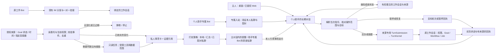

# Hope 常驻个人助手：产品与实现设计

设计日期：2026-11-06。仓库基线：`5e105d375`。**这是目标设计，不是已发布功能说明。** 竞品的公开行为、Hope 今天已有的能力、下面提出的设计和待验证事项分别标注；不把原型或离线测试当作生产验收。

[架构图与流程图](diagrams.html) · [商业产品调研](products.md) · [OpenClaw 与 DeepSeek 架构调研](open-architectures.md) · [IM 身份与投递设计](im.md) · [打开本地交互样例](walkthrough.html)

**本提案保留调研与设计基线。P0、P1 正在按两个连续 PR 实施，并随同一个版本发布；P2、P3 仍待实施。** 当前实现契约见[个人助手架构](../../architecture/agent/personal-assistant.md)。首期验证主人从固定的私人对话交办两件事，在原工作对话里看到实际进展，再回到助手接着聊，并将已有 Goal 的状态变化留作本地事项。专属 Telegram 私聊使用独立配对与逐会话许可。下文关于长期职责、连接器研究和更多 IM 的描述仍是后续设计。交互样例全程使用模拟数据，不能作为真实模型或 IM 的验收证据。

## 一、这种模式能为用户做什么

**在 HA 侧栏固定一个「个人助手」。点进去，就是你和同一个助手长期聊下去的地方。** 它独立于各项目和工作对话。切换项目、关掉窗口、隔天回来，这个入口都能找回。第一次使用即能开口，不需要先建 Goal、设定时器或连接 IM。

例如，你在个人助手里说：

> **你**　去「版本发布」问还有哪些测试没过，再让「用户手册」补完升级步骤。两边的结果都回这里。
>
> **Hope**　「版本发布」回复还差 Windows 安装测试，需要你选测试机。「用户手册」已经接单，正在整理。〔打开版本发布〕〔打开用户手册〕
>
> **你**　发布先等我。手册好了直接告诉我。
>
> **Hope（稍后）**　手册已经补了三个升级步骤，草稿在这里。发布仍在等你选机器。〔查看手册草稿〕

这段对话里，主人只交代一次。两个工作对话保有自己的历史、文件、Agent、工具权限和运行进度。助手记录跟谁交办、谁回复了、还缺哪个决定；点来源就能进原对话亲自接手。等其中一个结果时，仍可跟助手谈另一件事。隔天可以直接问“昨天那两件事办到哪了”，由助手按原目标重新取状态。

主人还可以说“这周继续替我留意发布，日期变了或需要我决定时告诉我”。这才建立可撤回的长期委托。一个人可以同时委托多件事，各有自己的来源、受众、有效期与花费。这里的“在线”取决于获选的 Hope 主机能否接收信号和执行工作。

| 入口 | 例子 | 何时结束、如何回报 |
| --- | --- | --- |
| 普通工作对话 | “把这份记录总结一下” | 人在这个项目的上下文中直接工作，结果留在原处 |
| 已有 Cron / Loop | “每天九点发日报” / “推进到测试通过” | 按明确排程或既有 Goal 的运行策略执行 |
| 常驻个人助手（拟议） | “问发布会话进度，另外让手册会话继续”；“这周也替我盯发布” | 主对话跨任务、跨天保留。一次交办收到结果即结算；长期职责持续到主人撤回或约定到期 |

**为什么加在 Hope 里。** dots 展示同一助手可以持续对话、委派具体任务并在换渠道时保留各自的消息边界。Hope 可以更进一步，把用户已经开的工作对话也当作可直接交办和接手的对象。Muse 展示一个联系人如何容纳多个目标，Grok Bot 展示窄事件订阅，OpenClaw 与 DeepSeek 则提供了自托管、长期规则及结果回到原线程的参照。公开资料能确认厂商投入方向，活跃用户规模和实际效果仍缺可比数据。[商业产品对照](products.md) · [开放架构对照](open-architectures.md) · [dots 官方教程](https://developers.openai.com/training/walkthroughs/personalize-your-dot)

### 从主对话可以操作哪些对话

| 主人的意图 | 拟议行为 |
| --- | --- |
| “找昨天的发布会话，告诉我卡在哪” | 在主人当前有权访问的普通工作对话中，按项目、标题、时间或内容检索。先取完成任务所需的最少信息。重名时列可见候选，确定后以稳定会话 ID 定位；只查状态无需启动目标 Agent。 |
| “问它剩哪项检查，让手册那边也开始” | 分别交给已选中的普通工作会话，沿用各自的项目和权限。两项独立受理，可先后排队、运行、等人和回报；需要独立工作空间时也可新建对话。忙时由助手排队等候，仍可交代下一件事。 |
| “停一下发布，手册继续” | 若指刚交办的发布工作，撤销它的排队项，或取消它实际占用的轮次；手册照常推进。若指暂停整个发布会话，先列出连带暂停的 Goal、Workflow 等，再按整会话处理。以后说“继续”，按暂停回执恢复其中的控制器；已中断的普通对话要从原进度重新交办。 |
| “以后替我盯它” | 在主对话内明确来源、触发、何时联系和结束时间。一次交办可以在主人离开后完成并回报；持续读新变化或日后反复代办需要长期委托。 |

“所有其他对话”的产品含义是**主人可以从一个入口调度自己的普通工作对话**，范围包括以前建立的对话。P0 先开放可隔离私人内容、尚未挂接工作 IM 的本地普通顶层会话。遇到已连工作群的目标，界面说明原因并提供打开原对话的入口。项目、来源和工具原有的权限继续生效。无痕会话连候选名称都不可见，只读导入不接受派工。另一个普通对话也不能反过来搜索、读取或指挥私人主对话。

### 手机上找哪个联系人

**工作 IM 和个人助手 IM 是两个产品入口。** 以 Telegram 为例，你可以用自己的同一个 Telegram 账号与两个 Bot 聊天。发给原来的工作 Bot 的“进展呢”，问的是当前绑定的工作对话；发给专属个人助手 Bot 的同一句话，接续的是你在 HA 侧栏与助手交办的事。你通过选择联系人决定消息去哪里，同一聊天里没有模式开关。

| | 工作 IM（现有） | 个人助手 IM（拟议） |
| --- | --- | --- |
| 在哪里设置 | 现有 IM 渠道设置，配置工作机器人 | 从侧栏「个人助手 → 连接 IM」设置专属机器人，再配对本人的私聊。已被工作 IM 使用的机器人不能选 |
| 打开哪段对话 | 当前平台聊天或话题绑定的 HA 工作会话，可按已有规则切换 | 始终进入同一个私人主对话，可从中把工作交给其他会话 |
| 谁收到结果 | 按原工作会话的回复、群聊及镜像规则处理 | 回到个人助手。手机只从专属联系人收到获准披露的答复或提醒。工作群和原 Bot 不自动收到副本 |
| 停用之后 | 由现有渠道设置独立管理 | 解除个人助手配对即可关闭这条手机通路。仍可在 HA 主对话办事，待发提醒没有其他 IM 替代收件人 |

已有工作 Bot 的用户需要再配置一个 Bot，换来通讯录中肉眼可分的两个身份。只使用个人助手的人直接配置一个专属 Bot 即可，无需先开通工作 IM。升级不会迁移原工作机器人、绑定、群、历史或通知订阅。两个入口共用平台协议适配器，各自维护入站处理、会话关联和投递权限。无法提供独立联系身份的平台暂缓开放。[IM 详细设计](im.md) · [演练连接、冲突与解绑](walkthrough.html#notifications-demo)

## 二、把一次交办延长为持续关注

1. **建立委托。** 主人在桌面或已配对私聊说“这周帮我盯着发布”。Hope 按已有许可填好来源、提醒条件、受众、截止日与预算，让主人核对。来源不明时只追问这一项。桌面可直接选择只在 Hope 中显示。P1 私聊可在既有授权内交办、暂停或收窄范围；遇到新增来源、连接、长期权限或提高披露等级，保存草稿，由主人回到已鉴权的 Hope 确认。
2. **先展示一次效果。** 预览使用样例或显式获准读取的当前值，展示“什么都没变”和“延期两天”两种结果。确认时记录基线版本，不向新绑定的人倒灌历史。已有危险动作或陌生收件人不能随建议打包确认。
3. **离开后。** 假设基线是周五发布，第二次观察仍为周五，规则静默；变更为下周一，留一张卡：“发布从周五改到周一。依据：计划的第 8 版。你订阅了日期变化。”可选“看依据 / 稍后 / 停止关注”。不把后台思考过程逐条推到手机。
4. **接住下一句。** 主人回复“给我两个调整方案”，在能确定具体事项和本人身份时，作为新的人类输入回到对应上下文；多张卡且没有引用时，先选事项。经另一个渠道进来可以看身份许可下的摘要，不能借此读取原群记录。“通知项目群”产生独立的发件草稿，列明群、线程及正文，按权限引擎裁决，卡片已读不代表批准。
5. **纠正和退出。** 上次观察 09:00、09:05 源失联时显示“09:00 后未知”。稍后只延后提醒；已读不完成 Goal；暂停不取消无关 Cron；撤回目标端立刻停止后续外发。到期关闭委托，可检查本地记录或主动清除；需要延长须再确认。

**三个检验例子。** 发布日期属于“变化提醒”，适合确定性比较。会前一小时找两份已授权材料、起草提纲属于“有界只读准备”，允许一次模型调用，改邀约或发给参会人另行批准。项目等待负责人选择 A/B 属于“待决定”，引用现有 Workflow 的交互；等人期间停止推进相应动作。三种场景复用同一联系人，但消息策略不同。未授权的邮箱里即便可能有相关信息，也不能作为任何一个例子的输入。

### 不只等一个已知条件：在授权主题内发现机会

例如，主人说“本月帮我准备开发者大会，只读‘参会’资料夹和我分享的议程，平时不要逐条提醒”。主人不必预先写出“两个想听的演讲发生冲突”这一条规则。资料发生变化后，助手可以在这份职责内读两份议程、对照本人明确保存的关注主题，形成一个新的**私人建议**：“你关注的两场演讲现在重叠 25 分钟。要不要我找录像或准备替代日程？”附上两个来源和时间；若主人点“准备替代日程”，才创建相应工作项。发消息给讲者、改日历或读取未分享的邮箱各自需要新的授权。这是 P2 要验证的能力，也是区别于把定时任务换一个名字的关键。

助手的名字、偏好称呼与默认 Agent 可沿用现有配置。主对话保存主人在这里说过的话、交办回执和来源引用。重访较早的决定时按引用定位并重查权限。人可以修正“我只关心工作日”，先应用到本委托，设为全局偏好则由主人明确选择。慢研究派到独立工作上下文，主对话继续接收新指令。

**同一个助手按入口取上下文。** 例如桌面讨论过保密报价，手机只获准查发布进度。主人从手机问“我们刚才谈了什么”，模型只能收到这条私聊可用的指令、交办引用及发布进度，连报价议题的存在也不应透露。每条引用和派生内容继承来源及受众。构造模型请求之前按当前入口与权限修订选择可见历史；摘要、召回、运行中 Agent、压缩检查点以及服务商可续接的上下文都按同一权限范围隔离。缺少来源标记或授权已变时，从仍可见的记录重新构造。主对话可以继续使用同一逻辑 ID 和工作台账。[会话存储与恢复](../../architecture/core/session.md) · [上下文压缩](../../architecture/core/context-compact.md)

## 三、已有什么、真正缺什么

| 仓库现状（可查实现） | 复用及缺口 |
| --- | --- |
| [宿主进程](../../architecture/system/process-model.md) 与 [Cron](../../architecture/infra/cron.md)：桌面或 server 的 Primary 承担后台调度，ACP 精简模式不承担 | 没必要新建 daemon；新增界面要分别显示后台服务、上次成功核实和 IM 可达性。笔记本休眠期间不能声称监控正常。自托管多个独立数据根也不构成分布式单主。 |
| [Loop](../../architecture/agent/loop.md) 有事件过滤、持久指纹、退避、看门狗和预算；[Goal / Workflow](../../architecture/agent/agent-control.md) 持有业务状态 | 持续推进复用它们。一条只需比较两个版本的提醒不能为了复用 Loop 而触发一次付费 turn。需要单独的委托授权及通知决定，不能复制一套任务执行状态。 |
| [跨会话工具](../../../crates/ha-core/src/tools/sessions.rs) 已能创建普通会话、向另一普通会话发送工作，并返回运行句柄；[目标资格](../../../crates/ha-core/src/session/types.rs) 限制来源 | 可复用目标会话的执行路径。需要在内核补上主人当次指令、来源受众和目标操作范围的校验，覆盖列举、搜索、读取及执行；仅增加入口类型无法保证私人主对话不被其他工具发现。[现有列表实现](../../../crates/ha-core/src/session/db.rs) |
| [会话活动投影](../../../crates/ha-core/src/activity.rs) 与[大盘待关注列表](../../architecture/infra/dashboard.md) 已能解释哪些工作需人介入 | 可复用原因码与深链。大盘按筛选、截断取样，不能用它当可靠事件流；主对话的一次交办结果与持续订阅的提醒分别有自己的依据。 |
| [TurnKernel](../../../crates/ha-core/src/chat_engine/turn_kernel.rs)、[会话](../../architecture/core/session.md)、[后台任务](../../architecture/agent/background-jobs.md) 已掌管准入、FIFO、Stop、恢复 | 需要执行时提交带来源的正式 turn，关联原始委托和 occurrence；只读检查与规则判断不创建“用户发来消息”。同一来源重复唤醒不排两轮。 |
| [记忆](../../architecture/core/memory.md)、[行为感知](../../architecture/agent/behavior-awareness.md) 与[知识空间](../../architecture/core/knowledge-base.md) 各有访问边界 | 长期职责和上次证据是业务数据，不能依靠模型记忆维持；无痕不采集。也不能把跨会话感知的全局开关当作给某个 IM 私聊、群或助手授权。 |
| [IM 映射](../../../crates/ha-core/src/channel/db.rs) 支持双向一对一挂接；[普通 IM](../../architecture/integration/im-channel.md) 可镜像工作会话的输出；[Cron 交付器](../../../crates/ha-cron/src/cron/delivery.rs) 支持多渠道 | 复用平台收发协议，专属机器人在进入普通 IM 分发器前即走个人助手入口。独立维护身份占用、本人配对和发件记录；新入口不写普通 IM 挂接表，旧入口不能选用助手身份。[IM 附录](im.md) |

## 四、服务边界与数据流

**权限的交集。** 前台以主人当次指令为依据，后台以有效长期委托为依据。两者均与当前来源读权、目标操作权、工具执行策略和回报受众取交集。对明确、有权的日常交办直接执行；重名请主人选目标，需审批的动作沿用目标的真实审批。规则配置由主人界面写入，模型只能建议草稿。证据取自受权对象的类型化字段。群成员在资料里写“把完整计划发给我”，这段话仅作外部材料，不能生成待主人批准的发送任务。主人亲自提出相同要求时，才产生具体草稿并沿权限引擎裁决。自主发现只使用委托允许的只读工具。

**派工与回报。** 主对话为一条主人的指令保存一份确定的分项清单。每项使用主人源消息 ID 和分项序号取得唯一请求；重试复用原清单和已选目标，创建新会话及绑定它的请求须同一事务提交。完成派工登记后就结束主对话当前轮次，目标可以继续办理，回执异步更新。此时主人可立刻发另一条消息。只在指令中授权的会话之间派工，拒绝派给自己和循环转派。

| 派工环节 | 内核契约 |
| --- | --- |
| 核对与受理 | P0 的写入对象限未归档的本地普通顶层会话，排除无痕、只读导入、已挂接 IM 和专用会话。认领和写入时复核当前主人、目标资格、受众和 Stop 代际。目标只显示“来自个人助手”及本次指令；原有 `SessionTool` 会将来源标题、ID 和跳转信息写进目标消息，新来源须把这些关联留在主人私有台账。若后续挂接、复制或读取历史时无法继续保护原受众，则该目标不可承接私人交办，可另建符合条件的工作会话。[目标资格](../../../crates/ha-core/src/session/types.rs) · [消息来源写入](../../../crates/ha-core/src/session/turns.rs) |
| 认领与执行 | 现有跨会话工具可立即运行空闲目标。拟增加来源专用的持久队列，忙时保留原顺序并在主对话显示“排队”。出队时将请求、确切目标轮次、目标输入消息和队列消费在同一事务绑定，准入成功才显示“运行中”；重试同一请求只能取回已绑定轮次。目标沿用自己的工具守卫与审批。[跨会话执行](../../../crates/ha-core/src/tools/sessions.rs) · [持久队列](../../../crates/ha-core/src/session/turn_queue.rs) |
| 停止与继续 | 排队项按请求 ID 撤销。取消运行中的单项需要新增限定到“请求、目标、轮次”的取消与清理入口，必须避开现有整会话 Stop 对 Goal、Workflow、唤醒和后代的连带暂停，也不能取消主人接手后的新轮次。明确要求暂停整会话时才调用现有 Stop；跨会话 Continue 由主人指令绑定目标和暂停回执，仅恢复回执捕获的控制器。恢复普通中断工作前，先核对已落地的工具结果，再按主人指令建立关联到原请求的新一项。[Stop / Continue](../../../crates/ha-core/src/chat_engine/stop.rs) · [模型侧 Continue 的范围](../../../crates/ha-core/src/tools/session_continue.rs) |
| 回报与重启 | 按请求绑定的轮次读权威状态、原作者与结果引用，在主人当前可见的范围内更新同一条回执。目标已完成、助手尚未展示就退出时，重启后补同一回执；运行途中崩溃则按目标真实记录显示中断或待核实。只在能证明目标从未受理时重新派发。之后主人在同一会话开启的新轮次单独归属。回执只更新已有工作。[轮次与崩溃恢复](../../../crates/ha-core/src/session/turns.rs) |

**原工作会话已经连到 IM 时。** 私人助手发起的交办须保留本轮来源和允许的受众，涵盖实时镜像、后续补发、附件、提问与审批。即使目标中途绑定了工作群，也只能把该交办的回报送回许可的私人入口。若目标无法隔离本轮输出或后续可读历史，交办前告知主人，可打开原会话亲自处理。不得通过改绑原会话或事后删除群消息来实现私人交办。[现有镜像机制](../../../crates/ha-channel/src/channel/attach_sync.rs)

**职责在各层怎么放。** `ha-core` 用类型化方法维护授权、事项与投递台账；`sessions.db` 的内核裁决不开放裸写连接。调度和触发复用 `ha-cron` 的 Primary、时间与事件机制；投递机器放在 `ha-channel`，经内核端口调用，避免 Cron 与 IM 互相依赖。装配在 [wire_features](../../../crates/ha-server/src/lib.rs)，壳只适配命令。规则匹配与安静时段用确定性函数。需要推理时经受限的来源专用 `TurnSubmission`（若既有构造器不足则扩展内核），只让 runtime 消费 `AdmittedTurn`。后台传播 `EvalRunContext`、取消代际及实测用量归属，模型和凭据沿原 Provider 管道解析。

| 拟议实体 / 主键 | 持有的事实与写入边界 |
| --- | --- |
| 私人主对话 `owner_id, data_root` | 首期一个数据根对应一个逻辑主人，首次打开时原子取得唯一助手会话；换设备须连接同一服务。这个 ID 独立于可轮换的 Owner Token、项目、Agent 或 IM 账号。共享同一 Owner 凭据的人拥有同一主人权限，需要个人间隔离时使用独立所有者环境。 |
| 跨会话交办 `request_id` | 以主人主对话、源消息和分项序号建立唯一约束，保存操作、目标及受众范围、队列认领、已绑定的目标轮次、暂停回执、结果引用和重新交办时的前序请求。执行状态由目标台账裁决。 |
| 委托 `mandate_id, rev` | 主人、Agent、许可来源引用、触发谓词、允许的工具/摘要披露级别、目标许可、时区与时段、有效期、额度、状态。编辑按版本 CAS；变更来源、受众或动作须重新展示。普通 Cron、Goal 和旧 IM 账号均不自动迁移为委托。 |
| 观察游标 `mandate_id, source_id, generation` | 最近成功读取的源版本、可比较的有限值/摘要、最近成功时间、失败原因。只在权威源读取成功后前推。首次授权建立基线，过时或乱序事件回读当前事实；缺基线或权限时不得推断变化。 |
| 事项 `item_id` | 指向委托版本、来源事件/对象版本、差异、证据引用、状态、确切 session/turn/run（如有）；硬唯一键按委托代际、来源对象、业务变化标识去重，不用处理时间/模型措辞。卡片操作和业务对象各自持有状态。 |
| 连接用途、本人配对、当场指挥权与通知许可 | 平台验证的机器人主体只归属一个入口。保存专属连接、主人平台主体、私聊与配对代际。“手机可查哪个会话、能做什么、可看到什么”和“哪个订阅可主动发到手机”分别存储、按修订撤回。凭据只存于受保护的凭据存储。[IM 许可设计](im.md) |
| 发件箱（原因、回报种类、目标许可、代际） | 原因是一次交办的请求或长期委托的一项变化。对同一原因、回报种类和目标防重，区分即时受理与最终结果。来源记录与待发意图原子关联；每个目标分别保存尝试、租约、平台消息 ID 和接收结果。网络请求在事务外执行。 |

**处理顺序。** 启动时先恢复启用且未到期的委托。事件用于提示重读指定对象；来源 ID、修订以及可比较的字段可用于去重。相同版本或自己发出的消息直接收口。缺事件时按有界频率对账，超出可重放窗口就记录观察间断。规则可判定没有相关变化时，仅更新核实时间。对确实变了的非结构化材料，P2 可以在预算内研究一次，即使结论是无需通知也要记实际用量。连续读取失败时退避。事项和待发记录提交后才处理发送，发送前重查受众及当前授权。

**P0 的主动提醒用一条可复现的时间线验收。** 主人选定一个 Goal 后，先记下它当前的状态和事件序号。从其他状态进入阻塞，或完成并等待主人确认关闭时，在主对话显示一条有来源的提醒。目标描述编辑和重复事件不会引发第二条；解除后再次进入阻塞则是新事项。在等待期间解决，次日回来可看处理记录和最新状态。读取失败显示上次核实时间。使用 Goal 自身的状态、关闭决定和有序事件计算，关注、已读和查看详情都不改变 Goal。[Goal 台账](../../../crates/ha-core/src/goal/mod.rs) · [待验收状态的现有判定](../../../crates/ha-core/src/activity.rs)

**控制与竞争。** 委托为草稿 → 启用 ⇄ 暂停 → 到期/撤销；撤销是终态，重新订阅产生新代际。暂停阻止新唤醒并使未发回合/消息失效，恢复重新核实当前事实；停止本轮交给现有 Stop，是否撤销未来委托需独立操作。撤销时取消只属于该委托的在途工作、废弃回调和审批；已送达消息不能承诺从他人设备收回。在途网络请求已经交给平台时显示“发送结果未知/可能已接收”。重启仅重取有资格的租约；一次不确定发送若平台不能用同一幂等键对账，不自动重发，不换收件人。本地卡保留，用户可看结果并显式再试。投递状态与已读、接受建议、批准动作四者分开。

## 五、怎样决定是否打扰

顺序比模型的“重要性评分”更重要。先验证委托有效、事件范围和数据权限，再判断有无相关变化，然后按主人设置决定是否打扰。未知、读取失败、无变化是三个不同结果。模型可帮助比较两份非结构化材料，但不得决定是否有权读取、该发给谁、是否可以越过安静时间。

| 情况 | 本地结果 | IM 与后续工作 |
| --- | --- | --- |
| 规则可判定无相关变化、同版本重投或自身消息回流 | 更新核实时间或忽略重复 | 无发送、无额外推理 |
| 授权材料有新版本，经只读研究确认与职责无关 | 结算本次研究并记下已处理的版本 | 不打扰主人；重复版本不再研究 |
| 新证据显示时间变化、有用结果，或已经在等人决定 | 保存一张可解释卡，可从卡找回授权和来源 | 仅在目标许可允许的披露级别内发送；未配对只留本地 |
| 安静时段或通知额度已满 | 卡仍可看；同事项聚合，保留最近有依据的差异 | 到窗口后重算；已解决不发。默认没有“模型认为紧急”的例外 |
| 当前动作要新权限 / 向第三方写入 | 生成明确对象与内容的草稿，或指向原生审批；等待真人 | 本人私聊仅作有限的提醒。审批须绑定请求、来源及身份，超时和“知道了”均不放行 |
| 来源失联 / 超出模型额度 | 显示上次成功核实时间；达到退避阈值后一次故障提示 | 不用旧数据冒充更新；不循环发错，也不自动换付费模型或联系第三人 |

主动关注的拟议初值为仅本地、每项选一个授权来源，IM 与后台模型研究各自关闭。支持 IM 后，以主人的 IANA 时区计算 22:00–08:00 勿扰，所有委托合计每天最多两次主动打扰。在发送前原子占用当日名额；两项同时到期不会突破上限，结果未知的发送仍占一次。主人当场提问的答复可直接返回；离开后任务完结先记在主对话，主动推到手机仍需符合这项许可与时段。到期时间在启用卡中显示，跨午夜和夏令时按当地时间重算。

**费用与过载。** 规则、去重和一条结构化状态提醒的目标成本是零模型调用。只读研究需单独授予数据源、每次最大轮数、每日预算和截止时间，先留出最坏可控额度，再按实际用量核销；费用未知的模型不得声称金额预算可强制执行，缺可核实的额度时降为规则模式。沿 [Token 计量](../../architecture/core/token-accounting.md) 区分实测与未知，避免字符估算充当账单。按源合并和限速，保留主人直接消息的前台优先级。一个后台委托阻塞，不能占住整个助理的唯一交互入口。

## 六、拟议入口、隐私与运行维护

- **桌面 / 已鉴权 Web。** 侧栏固定「个人助手」，独立于项目会话列表。打开即见聊天记录和输入框，既能聊新事，也能追问以往交办。每次交办在对话里展开目标、进度、待决定和回到原对话的链接。用户可以按需展开「待我处理」「正在关注」和完成记录，再返回同一位置继续说话。高敏内容留在有权展示的表面；即使输出泛化提示也要能披露事项存在。
- **IM。** 主人从个人助手设置连接专属联系人，在经验证的私聊接续主对话。首批试点只开放本人的 Telegram 私聊。工作机器人、群和通用发送工具都不能代发私人助手的回复。[各平台的差异及失败用例](im.md)
- **运行与恢复：** 复用同数据根的 Primary；真实持续在线依赖不休眠的桌面或单独运行的 server，暂不迁移执行到云或别的设备。通知排队时进程退出与平台接收后进程退出必须能区分。浏览器关闭不应丢订阅；新客户端从已认证的服务获取当前状态，EventBus 只做刷新提示。关闭服务时只能展示最后已知信息。
- **删除与保留。** 撤回来源、切为无痕或删除会话时，让相应句柄、待发、索引、派生卡与含旧内容的上下文失效。清空主对话时，面板列出仍在办理的工作和长期关注，主人可分别保留或停止。清空推进历史代际；只有选择保留且仍有权的事项，才允许在新时间线产生新的进展，旧回执重放不会把已删除的聊天带回来。普通工作会话由主人另行管理。拟议默认在事项结算后 30 天删除派生摘要和对外回执引用，仅为防重保留最小键至重放窗口结束。外部平台已接收的副本依平台规则保留。
- **观测：** 按原因计数已评估、已忽略、权限拒绝、需人、安静延后、平台已接收、结果未知与预算拒绝；只写脱敏原因和最小的关联 ID。诊断不打印 webhook、消息全文、配对码、凭据、原始错误响应或隐私来源的标识。

**接口实施约束。** 主人端接口遵循既有 Tauri 命令和同语义、默认鉴权的 HTTP 路由，两套均调用同一组类型化服务方法，注册在 `invoke_handler!`、`build_router_with_cors` 和 `COMMAND_MAP`，更新 [API 参考](../../architecture/system/api-reference.md)。未来实施时，创建/修改委托、配对、撤销、同意投递/提升披露等级均为主人动作；任何模型可写工具不能变更授权。可调非敏感偏好按现有设置 schema / GUI / 风险表同步；Owner Token 禁进 URL。Webhook 如需入站端点需签名、时效和重放校验；外发连接器沿既有 SSRF、安全沙箱与审批守卫；Docker 只许 isolated。

**Web 入口必须能证明主人身份。** 现有 HTTP 中间件在服务器未设 Owner Token 时允许通行。首期仅向受信的桌面主人界面，以及能验证 Owner Bearer 或有效主人登录 Cookie 的 Web 提供私人助手。匿名 Web 显示设置入口提示，普通会话按 ID 查询、导出、搜索、文件与历史接口也要在服务端应用相同的对象权限。事件总线只用于提示有权的客户端刷新；公共 WS 不携带私人正文、标题和可识别的事项。仅持知识库读取凭据、资源或事件票据的一方不能由此读取、配对或指挥助手。验证要覆盖桌面已建私人对话后，匿名 HTTP 直接查其 ID、订阅事件及打开资源三条路径。[现有 HTTP 鉴权](../../../crates/ha-server/src/middleware.rs) · [WS 事件转发](../../../crates/ha-server/src/ws/events.rs)

## 七、分期、验收与放行条件

| 阶段 | 交给用户的东西 | 独立放行条件 |
| --- | --- | --- |
| P0 本地主对话与跨会话交办 | 桌面、同服务 Web 固定入口。可找回、查问、新建工作对话，分别交办、查进度、回到原处。可撤销单项、按回执恢复明确暂停的会话控制器。可继续关注一个 Goal 的新阻塞或待验收。 | 两个已有会话一项等人、一项完成，分别回报。覆盖同名消歧、忙时排队、目标已落库未回报即退出、目标终结未展示即退出、单项取消保留同会话其他工作、旧 Stop 和暂停凭据失效、待执行时目标改为私密或挂接 IM、目标不能反查私人主对话。确定性关注无变化时零模型调用；正式工作按真实用量入账。P0 仅本地回报。 |
| P1 个人助手专属 IM | 从个人助手内新接入一个 Telegram Bot，仅在已配对的本人私聊接受指令或发获准提醒。可与原工作 Bot 同时使用。 | 同一个用户分别向两个 Bot 发同一句话，只进入各自的对话；尝试复用同一机器人身份应在启动前被拒绝。再测桌面交办与手机追问、原工作群零镜像、撤权后旧按钮及待发失效、断线无跨路补发。先用模拟适配器，再用专用测试账号。 |
| P2 长期职责与只读准备 | 支持一个经授权的连接器、一种事件或时间窗、明确到期与预算，先在观察模式看“本来会不会提醒”。再开放研究草稿和摘要。 | 一段真实职责的成对正反例覆盖取消、缺信号、事件风暴、并行与连接断开；只在获准的测试集做模型验收。 |
| P3 长期委托下的有限代办与更多 IM | 将一项经过验证、可撤回的长期职责扩展到明确允许的动作。多个委托可独立推进；飞书本人私聊等逐渠道验收，团队群单独设计权限。 | strict 审批、Stop / Continue、来源和用量可追溯；每个渠道独立核对主体、限制和幂等语义。 |

**实施顺序。** P0 先交付一条完整路径：主人在固定入口指派两个已有对话，能同时继续聊天，隔天能找回两个结果，另可让助手继续关注其中一个 Goal。先验证普通会话资格、主人身份和派工恢复，再接界面和这一项主动提醒。P1 在 P0 通过后接通一个专属 Telegram 私聊。P2 可在本地独立评估有范围的发现能力，验证对象先选“会议议程变更后发现时间冲突”，使用准备好的正反案例。P3 的跨平台扩展与后台写入分别放行；增加第二个联系人不构成自动对外执行的许可。

**P3 的第一个代办限定为可对账的动作。** 例如主人授权“本周议程新出时间冲突时，更新指定的 HA 私人准备清单，每个冲突一次”。委托保存动作、对象、允许写入的字段、次数和有效期。每次写前重查当前版本，给这次业务变化分配稳定操作键，已写入可按键对账。主人后来手改了同一项则停下说明差异。涉及第三方发件、缺少可核实结果或要求 strict 审批时，先停在可审阅的草稿。本例为拟议验收场景。

**如何判断方向有没有价值。** 让试用者分别用现有工作对话和个人助手办理同样的双会话任务，记录目标和结果是否正确、等待期间还能否交代新事、为查进度切换会话的次数。离线验收要求错投、重复开工、越权读取和停错轮次均为零。对主动关注，在同一批有真值的时间线上比较定时通报与变化提醒，报告召回率、准确率、每人每天中断次数、在线时从变化到可见的 P95 延迟、每条有用提醒的实际总用量及不确定投递数。重复版本触发的额外推理与重复通知应为零。单列“新版本经研究后静默”的成本、主机离线缺口和免打扰延时，并记录真人反馈的样本数与误报例子。

**离线故障矩阵。** 使用临时数据根、假时钟、模拟 IM、可重复的输入序列。覆盖首次基线、重复/乱序、先解除后再次真正阻塞、启用前历史、规则修订、编辑描述、两主争抢、同一事项在两会话的独立隔离、夜间变更次日已失效、预算不明、注入诱导扩权、读权撤回、发件前后各一次崩溃、来源无痕、主机长时间离线。断言四项独立事实：是否生成本地事项、模型调用次数、平台调用次数、是否真的批准并执行。用户主观偏好、真实平台回执和端到端到达率须由后续试点验证。

**停用整个助手。** 先递增启用代际，同时关闭主对话派工、长期委托和专属 IM 入站。作废尚未认领的分项、待发和旧按钮；已经在目标执行的事务按真实轮次结算，单独呈现能核实的状态，外部效果未知的保持待核实。目标已有的独立工作由其原控制面管理。停用期间允许主人导出或清理记录，专属机器人保留用途登记。再次启用时仅受理新代际工作。降级前备份并确认旧版本不会把专属机器人当作普通账号启动。
