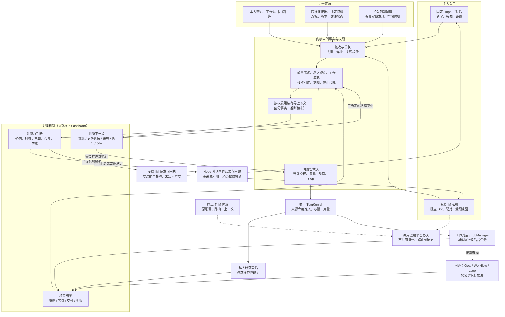

# Hope 主动助理：产品与完整机制设计

设计日期：2026-11-15。状态：按 A/B/C 连续实施，统一版本发布。A（#919）已合并，B 实现共享资料发现与到期复查，C 继续实现统一注意力与 IM。代码基线：远端 main `0a59f58db94ba44ffb867989e2a55355e5f0384f`，与本次工作树起始版本的文件树一致。

**Hope 是同一个长期在线、可以不断交代事情的个人助理。它理解正在发生什么，持续跟进已受托的事，在获准信息中发现机会，推进能做的工作，再选择合适的时机反馈。日常使用不需要建立 Goal。**

主对话、跨会话派工、助手资料、独立 Telegram 配对和有限通知已经存在；轻量事项已由 A 实施，B 增加明确共享的本地文件来源和私人研究；统一注意力由 C 接续。完整发布前不将阶段合并表示为版本已发布。现状以[已实现架构](../../architecture/agent/personal-assistant.md)为准。原 P0/P1/P2/P3 方案归档至[首轮设计基线](baseline-2026-11-06.md)，不再沿用其实施顺序。

配套文档：[运行、数据与接口契约](runtime-design.md) · [调研与机制映射](products.md) · [OpenClaw 与 DeepSeek 原型](open-architectures.md) · [整体审阅与修订记录](review.md)。

## 1. 用户应该实际得到什么

| 用户的处境 | Hope 的行为 | 用户看到的东西 |
| --- | --- | --- |
| “比较这两份方案，整理好再告诉我”，说完继续聊别的 | 后台完成比较，核实产物，主动回到原交办处结算 | 一条简短结论、文件、尚未解决的问题 |
| “这周替我留意发布，准备材料可以直接做” | 记住期限和范围，关注相关变化，准备获准的材料；有依赖时稍后继续 | 平时安静；需要决定或有可用结果时反馈 |
| 用户允许查看“参会”资料，并提过关注的主题 | 读到新版议程，发现两个重要活动冲突，即使用户没写“检测冲突”规则也能提出建议 | 两个来源、冲突影响、已准备的替代选项 |
| 工作在等外部结果 | 记录在等什么、何时值得再检查；有新信息后接着推进 | 不用用户反复问“然后呢” |
| 用户说“这件先别管了” | 停止这件事的自动跟进和后续待发；其他事项继续 | 一次确认，后来不会被旧事件重新激活 |
| 十条相关更新先后到达 | 合并理解，重查最终状态，形成一次有用反馈 | 不逐条推送，不报告已经自行解除的阻塞 |

以上场景的完整回放必须在没有 Goal、Workflow、Loop 的情况下成立。复杂执行可以选择现有控制器，助手自身的成立不依赖它们。

## 2. 调研如何改变本次设计

| 一手资料确认的机制 | Hope 的设计决定 |
| --- | --- |
| dots 的主动研究可读取获准来源、保存私人笔记；后续动作仍适用行动规则 | “发现机会”拥有独立只读能力集。研究结果不会自动变成写操作许可。[官方 FAQ](https://help.openai.com/en/articles/20001529-dots-privacy-security-and-safety-faqs) |
| Muse 在事件和时间驱动下并行推进，完成背景工作后判断是否值得报告 | 执行结果先进入结果判断，再进入注意力判断；后台有进展不必产生一条消息。[设计原文](https://muse.ai/blog/how-we-designed-muse) |
| Grok 主 Bot 会提出可代办的工作、跟进对话，例程另行承接明确自动化 | 同时支持开放式发现和已受托事项的持续跟进，用户不用先配置规则。[主动性手册](https://docs.x.ai/grok-bot/initiative) |
| OpenClaw 滚动文档把定期检查放入普通调度作业，任务完成有即时后续路径，可静默记录结果 | 周期检查复用持久调度；完成、答复、依赖变化直接触发跟进；检查和发送分别记录。[当前文档](https://docs.openclaw.ai/gateway/heartbeat) |
| DeepSeek 公开原型区分事件判断、授权事项、执行分配和投递，只把可用结果和人需行动的事项交给人 | 轻量事项独立于执行轮次，执行与发送单独对账。[领域模型](https://github.com/deepseek-ai/dsh-superagent-prototype/blob/main/docs/001-domain.md) · [交互原则](https://github.com/deepseek-ai/dsh-superagent-prototype/blob/main/docs/000-philosophy.md) |

这些是公开产品行为、滚动文档或研究原型的机制证据，不代表掌握它们的内部架构、提示词、效果或成本。下面的组件、数值和数据结构是 Hope 的设计选择。Muse 虽有 Goals 界面，其命名也不能直接等同于 HA 当前的 Goal 控制面。

## 3. 一种助理，两条主动路径

**持续跟进**围绕已受托的事：用户的明确交代、已有工作返回、依赖变化、到了适合再看的时间。Hope 在已有范围内决定下一步，直到交付、等待用户或被停止。

**主动发现**围绕用户允许它了解的领域：结合关注偏好、近期上下文和获准资料，发现遗漏、风险、冲突及可准备的工作。用户授权的是关注范围和读取能力，不必预先穷举“什么条件算有价值”。发现先形成私人观察；是否可以代办由现有授权另行裁决。

“最近很关心发布”可以成为本次助理上下文里的关注偏好；“这周帮我盯着发布会话”才构成持续委托。含糊的愿望不能自行扩成全盘监听、对外发言或无限后台计算。

两条路径共用背景上下文、执行、结果和反馈机制，分别保留触发原因、权限依据、用量和用户反馈。已明确交办的事无需用户再逐步指挥。

## 4. 轻量事项和助理上下文

### 4.1 一句话建立事项

一个日常事项只需要保存：**要帮忙做什么、来自哪句话、关联工作、当前进展、下次跟进依据、允许做什么，以及何时结束**。明确任务的结束条件可由原话给出，如“整理好两份对比”；没有结束日期的长期关注采用可见的到期默认值，启用时说明。

用户不用填写 rubric、证据表、阶段图、验收申请或预算对象。需要澄清时只问影响执行的缺失项。允许范围内的日常步骤直接推进。事项状态只有“进行中、等待、已交付、已停止”；等待原因和检查时间是附属信息。

“已交付”要求有与原请求相符、已核实的结果。完成一个执行轮次、结束一个 shell 命令或创建一个草稿，都不能自动结束整件事。草稿、部分完成、待核实、等待人各自明确呈现。主人可以自然追问和补充约束；涉及新范围时使用新的授权，不能暗中扩大旧事项。

### 4.2 关注偏好与工作笔记

助理上下文由近期对话、获准的工作引用、未完事项及短工作笔记构成。偏好帮助判断相关性，权限由宿主单独保存和校验。

工作笔记是有来源、可修正、可清除的私人业务记录，服务于当前事项和发现；不自动写入用户全局记忆。自动召回关闭时不会借助此功能恢复召回。默认不采集其他普通会话，更不采集无痕、未分享项目或工作群。资料撤权后停止新的读取和派生披露。

### 4.3 默认就能跟进，额外发现单独开启

首次使用可跟进本人在 Hope 里明确交办的事，以及这些事项产生的执行状态和结果，无需连接外部应用。额外的后台发现由主人选择来源并开启；只连接应用不自动开始监听。添加来源时显示访问范围、读取方式、最近检查时间、失联状态和实际用量。

## 5. 总体架构

图中“助理机制”负责选择下一步，不实现另一套 Provider 或工具循环。所有需要模型或工具的正式轮次仍进入现有内核。来源、事项、执行和通知之间有持久引用；EventBus 只提示刷新，不承担唯一事实存储。

## 6. 主动发现：从信息形成有价值的判断

一次发现依次经过：

1. **接收。** 来源适配器保存新游标、事实版本和健康状态；同一事件只登记一次。定期检查也有明确的发生标识。
2. **筛选。** 宿主核对当前读取许可、来源资格、到期和研究额度，合并同主题信号。明确重复或没有有效变化的结构化事件无需模型。
3. **理解。** 对需要判断的材料，私人研究轮次比较新旧信息、相关工作和主人关注点，回答“为什么与这个人现在有关、会造成什么影响、可以准备什么”。
4. **留证。** 保存来源版本、观察时间、事实、推断、不确定性、建议和有效期；没有证据时保留未知，不编造“无变化”。
5. **选择。** 无价值则静默；值得准备且已在权限内则继续研究或执行；尚未受托的机会形成私人建议。

私人研究只能使用已登记的只读操作，不能调用 shell、任意 HTTP、浏览器控制或写连接器来绕过限制。可以把整理后的内容写入助理自己的私人工作笔记；第三方文档、共享文件和外部应用保持各自的操作许可。

发现不依赖预写关键词。关键词、版本比较只承担低成本预筛，语义判断负责真正的机会发现。提示词要求解释来源和价值，但模型的重要性评分不能放行权限、提高额度或越过勿扰。

## 7. 持续跟进：把等待也管理起来

每件事保存一个可解释的后续依据：等待工作返回、等待本人答复、等待外部事件、指定时间再看，或已无后续。后台有新情况时更新同一事项，避免每次回调都新开工作。

| 发生的事 | 后续处理 |
| --- | --- |
| 具体步骤完成，原请求尚未满足 | 根据已有结果继续下一步；在现有范围内重新派工 |
| 等待命令、工作会话或资料更新 | 订阅实际结果；只有事件不可靠时才增加低频检查 |
| 外部暂时失败 | 对可安全重试的只读步骤有限退避；次数耗尽后报告未知与建议 |
| 需要主人选择 | 留一个具体问题、背景及推荐方案；无回答则等待 |
| 主人回答 | 重查该问题、当前版本和授权，继续原事项 |
| 主人停止事项 | 递增停止代际，撤销待执行和待通知；处置确切在途轮次 |
| 本人只是推迟提醒 | 仅修改联系时间，事项按既有授权继续 |
| 来源失联或主机离线 | 标注最后成功观察时间；恢复后重查现状 |

自动继续来自仍有效的委托；普通历史、外部消息和旧回执不构成新授权。用户 Stop 后不自动恢复，需要新的明确 Continue/交代，并使用现有暂停回执规则。无回答、超时和默认推荐均不能当作同意。

跨天的问题使用持久的事项答复目标，等待时结束当前轮次并释放资源。次日或重启后仍可回答；答案和下一步一次性落库，不依赖旧工具调用仍在内存等待。执行、核实、重试和子工作都累计归属原事项的后台额度，不能每换一轮就重新获得额度。

## 8. 后台执行与结果核实

前台主对话持续接收新消息。慢研究、具体动作在独立私人上下文运行，不能占住与用户交流的唯一会话。用户发来补充时，宿主验证其指向的事项，把范围内的新信息交给已有工作；无关新事独立受理。

执行复用工作对话、共享 FIFO、JobManager 和现有权限、审批、用量机制。具体工具仍受工作区、网络、来源、strict 审批及 Stop 约束。Goal 等控制器可以作为某次复杂工作的执行手段，日常跟进不创建这些对象。

一次工作返回先生成结果事实：执行是否结束、预期产物是否存在、请求哪部分已满足、剩余什么、外部副作用是否可核实。需要推理的核实进入有界正式轮次。轻量任务可用来源回读、文件检查等完成核实，复杂任务才增加专门验收。

结果与后续计划在同一结算事务落库，外发在事务之后处理。重启按实际轮次、产物和操作键对账；无法证明是否已发生的外部写入保持“待核实”，不能为了完成事项自动重做。

## 9. 反馈与免打扰是独立的一层

**干了什么、是否有结果、是否联系用户，是三个不同事实。** 提醒额度用尽不停止合法工作；工作完成也不自动产生手机推送。

| 情况 | Hope 主对话 | 主动外部提醒 |
| --- | --- | --- |
| 用户正在提问 | 正常直接答复 | 仅回当前渠道，不额外双发 |
| 已交办工作的可用结果 | 写入一次结算更新，附产物与未完项 | 按主人选择的通知范围和时段发送，可合批 |
| 阻塞且确实需要主人决定 | 一个具体问题、选项和建议 | 在允许时联系；等待期间不周期催问 |
| 新发现的高价值建议 | 少量有依据的建议，能看出为何现在相关 | 默认先本地；主人开启后再按统一策略联系 |
| 普通进展、相同结论、价值不足 | 更新内部进展；有需查看的进展可展开 | 静默 |
| 失联、凭据失效 | 区分无法检查与没有变化 | 首次影响工作时合并说明；故障风暴去重 |

注意力判断先核验授权与有效性，再看重要变化、可行动性、时效、是否已告诉本人、是否已经解决，最后应用时段、冷却和额度。模型给出解释，宿主执行硬规则。

拟议初值：22:00–08:00 勿扰；全部事项和渠道合计每天最多两次主动提醒尝试；同类普通结果用 60 秒窗口合并。正常问答不占主动额度。主人主动查看产生“已在此处看过”信号，可抑制尚未提交的等价手机提醒。仅窗口可见不算已读；通知被点击也不代表同意动作。

“每天”同时受当前时区的当地日和滚动 24 小时两道上限约束，跨午夜或改时区不会立刻补出名额。服务端 Primary 和桌面 Secondary 共用事务性的策略生效门；设置未被执行端应用时显示待生效，关闭提醒的请求会先阻止新的发送认领。

到可发送时再次检查：夜里发生但早上已解除的阻塞不再推送；内容变了就重新判断，不能发旧草稿。无有效主人 IANA 时区则不做定时外推，仍可在主对话查看。紧急评分不会绕过勿扰或日上限；主人需要例外时由主人设置明确范围。

用户可说“少一点这类建议”“这个不用提醒”“明早再说”。分别作用于建议偏好、本次提醒和联系时间，不能混成停止工作或授予新行动权限。偏好长期生效前在对话中说明应用范围，并提供撤销。

## 10. IM：同一个助理身份，保留独立的受众边界

原工作 IM 继续使用原账号、会话挂接和群聊规则。Hope 的专属联系人使用独立 Bot、配对、命令台账和私聊视图，配置保留在“助手设置 → IM”。两侧只复用平台协议和受控执行能力。

本次设计扩展的是**有授权的事项连续性**：

- 在桌面交办的事项可以按既有通知许可回到本人专属 IM，无需必须先从 IM 发起。
- 手机追问“那份对比怎么样”时，用获准的事项引用续接，不能直接导入桌面主对话全文。
- 默认仅投递状态；主人明确允许摘要后，逐项检查摘要所有来源的披露权限。结果正文、附件和记忆不会因开启状态提醒一并开放。
- IM 可以回答当前有权的问题、交办范围内的新任务、停止获准事项。新增来源、扩大持续操作范围和披露等级仍走主人设置或明确确认入口。
- 各渠道保存自己的对话；后台事项可以共享身份引用。群里转发一个事项 ID 或按钮不获得读取权。

统一反馈先产生一份逻辑更新，再选择当前合适的获准渠道。默认一个提醒只主动投递一个渠道；传输失败不自动改投另一渠道。平台接收、用户已读、用户回答、批准动作分别记录。未知发送状态保留待核实，不盲目重发。

## 11. 界面保持简洁

侧栏固定 Hope 头像入口，默认名字 Hope、默认 Hope logo，支持已有改名换头像。进入后仍是同一个长期对话，输入框保持简洁。

后台产生的可用结果和问题以普通对话中的紧凑更新呈现，能看到“为什么找我、结果/建议、必要时一个操作”。不要求打开事项面板才能知道需要回应。展开详情才看来源、执行记录、花费和待发原因。

“事项”面板继续默认收起，按“正在做、等我回应、最近交付”查看轻量事项，不增加 Goal 管理表单。头像附近只显示简短运行状态，例如“正在整理两份方案”“服务离线，最后检查 09:10”。

助手设置分为资料、主动性、可用来源、IM。主动性提供“只跟进我交代的事 / 同时发现有价值的机会”、勿扰时段和可选高级用量限制。关闭新建议不停止已经受托的工作；“暂停整个助手”单独说明影响范围。原工作台操作继续可用。

## 12. 常驻、时间与成本

常驻由选定的 HA Primary 进程承担。关闭界面而服务仍运行可以继续；主机休眠、服务退出或来源断开时不会声称仍在检查。首次基线记录当前情况，历史事件只作上下文，不作为一批新指令重放。

发现调度和任务跟进分开：任务完成、回答和重要依赖变化走即时后续；周期发现复用持久调度器。研究让位前台，已在执行的工作沿原生命周期结算。没有新输入时可做有界复查，禁止一轮研究无限生成下一轮。

以下是待真实试点校准的初值，不是竞品数据或已验证效果：

| 控制 | 拟议初值 |
| --- | --- |
| 额外来源后台发现 | 新装与升级均默认关闭；明确交办的事项正常跟进 |
| 研究并发 | 每个主人 1 个；实际工作仍用现有各资源池 |
| 发现到期扫描 | 30 分钟检查到期状态；无变化日最多每 2 小时允许一次开放式复查 |
| 一次研究 | 最多 2 个正式轮次、8 次只读工具调用、90 秒 |
| 每日研究 | 最多 8 个正式轮次；按实际用量入账，不能把失败当免费 |
| 单项后台执行 | 累计最多 8 个正式轮次、64 次工具调用、30 分钟活跃执行，单项最多 2 个执行分配；核实、重试、子代理均计入 |
| 主人全部后台执行 | 滚动 24 小时最多 16 个正式轮次、128 次工具调用、60 分钟活跃执行；持续委托的新事项也累计，不能换事项重置 |
| 未指定期限的持续关注 | 默认 7 天，建立时明确告知；到期不自动续订 |
| 模型金额预算 | 仅在价格和真实用量可核实时承诺硬金额限制；否则显示未知并用次数/时间限制 |

前台直接任务和持续事项的执行用量单列，不偷偷挤入“免费发现”。达到研究额度只延后研究；执行额度/权限不足则让对应事项明确等待。无变化的确定性比较不调用模型，不为“保持在线”生成消息。

次数、活跃时间和并发上限由宿主执行；等待用户/来源的时间不占活跃执行，但实际运行中的工具和子代理照计。额度耗尽不创建另一事项接力，Home 留下已完成部分、剩余工作和一个追加额度的选择。主人明确追加后才恢复，额度调整不影响 strict 审批。上述数值是初值，使用者不需要每件事填预算表。

## 13. 实施顺序：先做完整的主动闭环

本次设计不继续把主动性留给不确定的后续阶段。首个可发布版本必须同时跑通轻量跟进、一个非 Goal 的主动发现例子、后台准备、结果回到 Hope，以及专属 IM 和免打扰。

| 实施单元 | 范围 | 合并条件 |
| --- | --- | --- |
| A 轻量事项与持续结算 | 核心台账、权限引用、任务返回与等待、可恢复后续、Home 主动结果 | 无 Goal 完成双事项；一项等待时另一项可交付；停止与重启不重复执行 |
| B 主动发现与准备 | 本人分享的版本化本地资料作为第一个真实来源；有界只读研究、私人观察、范围内准备 | “议程改版 → 发现本人关注活动冲突 → 准备替代方案”完整跑通，包含该静默和该取消的反例 |
| C 统一注意力与 IM | Home 更新、价值判断、摘要权限、桌面交办到专属 IM、合并/已读/勿扰/回执 | 同一事项跨端可追问；夜间已解除不发；桌面已读不重复推；未知投递不重复提交 |

三个单元可拆 PR 连续实现，但本版本的“主动助理”验收以三者共同通过为准。可以先在观察模式积累样本，试点开关应如实标明能力，不能把只有派工和 Bot 的状态称为完整主动助理。

外部邮箱、日历、GitHub 等连接器逐个增加，复用同一来源契约；更多 IM 逐渠道验证。扩大来源和平台不是首条闭环成立的前提。

升级保留原 Home、名字、头像、派工和 Bot 配对。旧 Goal 关注作为一种来源适配器保留，既有 Goal 不迁移为事项控制器；已有明确派工可建立引用，不生成历史提醒。旧权限不升级为摘要或新来源权限，旧通知上限不因升级提高。

## 14. 产品验收与效果评估

确定性场景见[运行契约中的验收矩阵](runtime-design.md#10-验收矩阵)。核心产品场景全部禁止创建 Goal，至少包括：

1. **交代即跟进：** 连续交办两件事，保持聊天，后台各自交付；不再发问也能收到结果。
2. **主动发现：** 只给资料范围和关注点，未写触发条件，发现新冲突并给出有来源的建议。
3. **主动准备：** 在已允许的范围内准备替代方案，不把“建议有价值”当作外部写入许可。
4. **低干扰：** 重复事件、无变化、已解除问题、已看过结果保持安静；有效决定不能被静默丢掉。
5. **跨端：** 桌面交办、手机追问和获准反馈连续；原工作 IM 没有私人内容。
6. **可控：** 停止、推迟、撤权、离线恢复、配额耗尽和未知投递都有准确语义。

一条完整时间线可以这样验收：主人允许读取参会资料并在私人空间准备日程；新版议程到来后，Hope 自行发现关注的活动冲突，准备两个替代方案；主人正在处理其他事，进度留在后台，方案就绪才回到 Home。主人在桌面看过后，等价手机提醒取消。夜里又出现变更，延后到白天重查，已解除就静默，仍需决定才通知本人；主人从专属 IM 回答后接续同一事项。期间可重启，旧问题仍可作答；订票或联系他人仍须对应动作许可。

离线成对样本测“该发现/该推进/该提醒”和“应静默/应等待/已取消”，分别报告准确率、召回率、错误动作及故障原因。真实模型评测按现有隔离契约显式运行；真实 IM 用专用账号，不以模拟投递代替平台验收。

真人试点记录实际推进的事项、结果可用率、主人追问次数、漏掉的关键决定、无效提醒、每人每日中断和每条有用发现的实际成本。样本、模型、来源版本、在线缺口和分母必须一起报告。当前没有这些实测结果，本提案不提供体验分数或竞品优劣结论。
